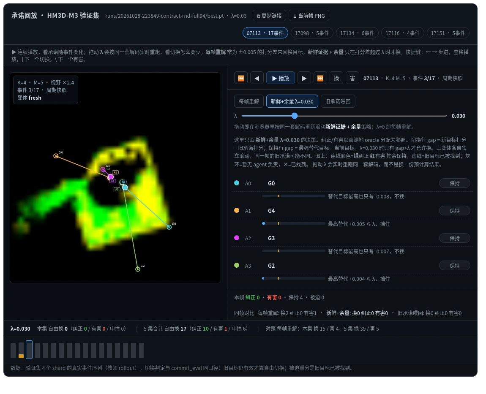
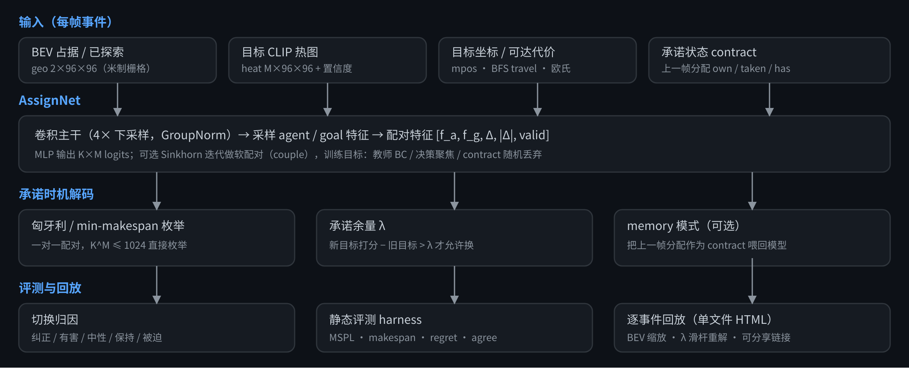
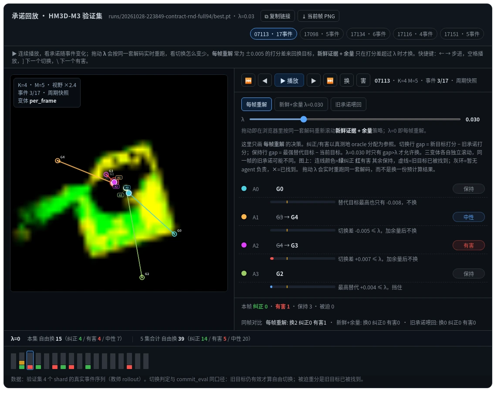

# m3-assign

多智能体物体导航（HM3D-M3 / OVON 风格）里的**目标—智能体分配**策略：把每帧的 BEV 占据/已探索图、每个目标点的 CLIP 热图、BFS 代价喂给一个小网络，输出 K×M 的配对打分，再用匈牙利做一对一解码。

这个仓库同时包含我们做「承诺感知」的一系列实验代码：Sinkhorn 配对、决策聚焦微调、以及**承诺时机（commitment timing）**——什么时候该坚持原目标、什么时候该换。

▶ **[在线打开交互回放（GitHub Pages）](https://williamtymhuabian.github.io/m3-assign/commit_replay.html)** · 离线版是仓库里的 [docs/commit_replay.html](docs/commit_replay.html)，下载后双击即可



## 方法概览



## 结果快照（同一批 400 个 val episode，越低越好的是 makespan / regret，越高越好的是 MSPL / agree_oracle）

| 分配器 | MSPL | makespan | regret | agree_oracle |
|---|---|---|---|---|
| oracle（真测地最优） | 1.000 | 10.13 | 1.000 | 1.000 |
| 匈牙利（真测地，特权基线） | 0.842 | 12.57 | 1.116 | 0.564 |
| balanced（官方 routing 基线） | 0.816 | 13.38 | 1.171 | 0.490 |
| teacher（数据里的教师分配） | 0.781 | 13.88 | 1.191 | 0.676 |
| AssignNet + 匈牙利（`couple3r`） | 0.777 | 13.64 | 1.218 | 0.416 |
| AssignNet + 匈牙利（`full94` + contract） | 0.794 | 13.33 | 1.168 | 0.470 |

结论写在 `reports/` 里：学习到的分配器已经超过"模仿教师"，但**没有超过特权几何的匈牙利**。这个 harness 是静态的（用 episode 自带测地矩阵折叠成团队指标），没有感知闭环，所以这些数字只适合做分配层之间的相对比较。

## 承诺时机

检测到目标/周期快照时，模型每帧都能重新分配。问题在于打分差常常只有 ±0.005，于是目标在 A、B 之间来回跳。

- `per_frame`：每帧用新鲜打分重解（基线）
- `fresh@λ`：新鲜打分 + 余量，只有"新目标的打分 − 旧目标"超过 λ 才允许换
- `memory@λ`：把上一帧的分配作为 contract 特征喂回模型

在 6 个 half-split 测试里，`fresh@0.03` 把切换率压低 19–26%，自由 churn 从 0.43 降到 0.25–0.33，有害切换的净变化从 −58…−95 收窄到 −13…+7，与 oracle 的一致率在 5/6 个测试里 +1.1–1.8pp。`memory@` 在干净模型上会把错误承诺锁死（几乎不再换），加 contract 随机丢弃训练后变成一个"安全的粘性策略"，但路线质量仍不如 `fresh@`。

## 交互回放

`docs/commit_replay.html` 是单文件、可离线打开的回放器（数据已内嵌）：

- 画布是真实 BEV 图 + 目标/智能体位置，按 episode 自动缩放
- 每个事件的决策标成 **纠正 / 有害 / 保持 / 被迫重分**，gap 条上画出本帧 λ 的位置
- **λ 滑杆**：在浏览器里用同一套解码重新滚动，实时看"有害切换先消失、真纠正还在"
- 时间轴、同帧三策略对比、`]`/`\` 跳到下一个切换 / 下一个有害、`#ep=&ev=&lam=&v=` 可分享链接、当前帧 PNG 导出

同一帧（`00746` 第 3 个事件）两种承诺时机的差别：

| `per_frame`（λ=0） | `fresh@0.03` |
|---|---|
|  |  |

左边每帧重解会把 A1/A2 的目标互换（判为中性 + 有害），底栏是 5 集合计 39 次自由换 / 5 次有害；右边加 0.03 余量后同一帧全部保持，合计降到 17 次 / 1 次有害。两次截图对的是同一批 logits，只是解码用的余量不同。

重新生成：

```bash
python -m m3assign.commit_trace --ckpt runs/<run>/best.pt --episodes 5 --out cache/commit_trace.json
python -m m3assign.commit_view  --trace cache/commit_trace.json --out docs/commit_replay.html

# 不装数据也能跑：用仓库里的样例 trace（1 条真实 episode，17 个事件）
python -m m3assign.commit_view --trace examples/commit_trace.sample.json --out /tmp/replay.html
```

样例字段说明见 [examples/README.md](examples/README.md)。

## 仓库结构

```
m3assign/
  data.py          shard/episode 访问，M3_ROOT 解析
  model.py         AssignNet（BEV+热图+BFS -> 配对 logits），Sinkhorn couple()
  train.py         BC / 决策聚焦 / contract 随机丢弃 / start-only 等训练开关
  sim_eval.py      静态几何评测（SR/MSPL/regret/makespan）
  commit_eval.py   离策略承诺时序评测（切换分类、churn、oracle 一致率）
  commit_trace.py  导出逐事件回放轨迹（含 contract-free logits）
  commit_view.py   轨迹 + 模板 -> 单文件 HTML
  assign.py        margin 解码与切换归因（纯 numpy，不依赖 torch）
  headroom.py      误差分解：代价来源 × 分配目标 × 路线顺序
  worldmodel.py    绕路系数 + 可达性预测（终端代价的世界模型）
  server.py        本地看板后端（训练曲线 / episode 轨迹 / 热图）
  web/             看板与回放前端
setup/              环境搭建与 habitat-sim 诊断脚本
tests/              解码语义与样例轨迹的单元测试（不需要数据和 torch）
examples/           可离线重建回放的样例轨迹
reports/            实验报告
docs/               静态回放页（GitHub Pages 可直接开）
.github/workflows/  CI：ruff + pytest（Python 3.10 / 3.11）
```

## 环境

- Python 3.10+、PyTorch、numpy、scipy、safetensors、Pillow
- 数据：HM3D-M3 的 `teacher_100k` shards 与 episode JSON。用环境变量指向自己的拷贝：

```bash
export M3_ROOT=/path/to/VLN      # 下面是 HM3D-M3/ 和 hm3d-m3-code/
```

`m3-assign` 默认假设自己位于 `$M3_ROOT` 下一层（本机布局），所以克隆到别处时请显式设置 `M3_ROOT`。

## 常用命令

```bash
pip install -r requirements.txt

# 训练（BEV 翻转增强 + 4 shard 验证）
python -m m3assign.train --train-shards 16 --val-shards 4 --name bc

# 加 Sinkhorn 配对
python -m m3assign.train --couple-iters 3 --name couple

# 带 contract 特征 + 20%/20% 随机丢弃
python -m m3assign.train --contract 1 --contract-drop 0.2 --contract-rand 0.2 --name contract-rnd

# 静态几何评测（400 val episodes）
python -m m3assign.sim_eval --ckpt runs/latest/best.pt --episodes 400

# 承诺时序评测（half-split 调参/留出）
python -m m3assign.commit_eval --ckpt runs/latest/best.pt --half 1 --mode fresh

# 看板
python -m m3assign.server --port 8765 --host 0.0.0.0

# 单元测试 + lint（纯 CPU，不需要 torch / 数据）
pip install -r requirements-dev.txt
ruff check . && python -m pytest -q
```

## 已知限制

- 评测用 episode 自带的测地矩阵把分配折成团队指标，**不重跑仿真**；轨迹回放同样是离策略（每个变体在日志事件上自己维护 contract）。
- 分配层之外的东西（感知、导航、实机）还没接进来。
- 打分完全并列时（±1e-4 的对称解），浏览器端枚举与 scipy 匈牙利可能选到不同的并列最优解；λ 等于离线评测值时回放直接用离线决策，避免两边数字对不上。
- 起点帧上的缺口主要在**解码目标**而不是信息：真测地 + min-makespan + 最优访问顺序可以复现 oracle，而只学“绕路系数”的世界模型目前还不如纯欧氏 min-max（见 [reports/baseline_compare.md](reports/baseline_compare.md)）。

## 引用与许可

- 代码以 MIT 许可发布，见 [LICENSE](LICENSE)。
- 引用信息见 [CITATION.cff](CITATION.cff)；GitHub 仓库页右上角 “Cite this repository” 会直接给出 BibTeX。

## 致谢

建立在 HM3D-M3（ma_objectnav_ovon）的数据、教师 rollout 与官方 `benchmark.metrics` 之上。本仓库只包含分配层的研究代码，不含数据集与场景资源。
